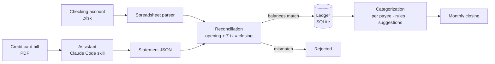

# fproject

**Local-first personal finance.** Import your monthly bank statements, see where your money goes, and plan for what you want next.

> 🚧 v0.1: usable for importing, categorizing and closing a month. Built in small, reviewable steps; see the [roadmap](#roadmap).

## Why

Banking apps show transactions. They don't answer the questions that matter at the end of the month:

- How much came in, and how much is left?
- Where is the money actually going, and how does that compare to last month?
- Am I within the limits I set for myself (e.g. food delivery)?
- I want to travel to Japan in 8 months for R$ 40,000. Is that feasible, and what has to give?

fproject answers these from your own statements, on your own machine.

## How it works



1. **Ingestion.** Every format sits behind one `Extractor` interface. Structured exports get a deterministic parser. Layouts no parser handles, like credit card bill PDFs, are turned into a documented JSON format by an assistant ([the skill](.claude/skills/extract-card-bill/SKILL.md)), and later by an API-based extractor writing the same JSON.
2. **Reconciliation.** Before anything is stored, the transactions must add up to the statement's own totals (row by row when the bank provides a running balance). This is what makes any extractor trustworthy, including an AI one.
3. **Ledger.** A statement is unique per *(account, reference month)*. Transactions get a generated UUID; no bank-provided identifier is trusted as a key. Raw data is never modified.
4. **Categorization.** A separate layer: one decision per payee, every confirmed decision becomes a rule, and an assistant can pre-fill suggestions that only count once you confirm them.
5. **Closing.** A consumption view over all accounts: a credit card bill payment is replaced by the bill's items, transfers count nowhere, investments count as saved.

Decisions behind these choices are recorded in [docs/decisions](docs/decisions/).

## Design principles

- **Local-first and private.** SQLite on disk, web interface on localhost. No personal data in the repository; tests use synthetic statements.
- **Money is an integer.** Amounts are stored in cents, signed: negative is outflow, positive is inflow.
- **Trust, but reconcile.** No import is accepted unless it balances.
- **AI proposes, you confirm.** Assistant output goes through the same validation as everything else and never overwrites a human decision.
- **Start small.** Each layer has to be useful on its own before the next one is built.

## Usage

```bash
uv sync
uv run fproject web          # http://127.0.0.1:8000: import, review, closing
```

Everything the web interface does is also available from the command line:

```bash
uv run fproject import statement.xlsx --owner jane --institution "Acme Bank"
uv run fproject check bill.json                          # reconcile without storing
uv run fproject import bill.json --owner jane --institution "Acme Bank" --kind credit_card
uv run fproject categorize export 2026-09 -o request.json # payees awaiting review
uv run fproject categorize apply suggestions.json         # assistant suggestions, unconfirmed
uv run fproject close 2026-09                             # monthly closing
uv run fproject summary 2026-09                           # raw per-account cash flow
```

With the synthetic export used in the tests, an import looks like this:

```console
$ uv run fproject import statement.xlsx --owner jane --institution "Acme Bank"
jane · Acme Bank (checking)
  2026-08     2 transactions  imported
  2026-09     3 transactions  imported
  2026-10     1 transactions  skipped: month not over yet
```

Import rules:
- Every month must reconcile or nothing from the file is imported.
- A month is imported once. Overlapping exports are fine: months already imported are skipped.
- For checking accounts, the current month is skipped until it ends, so a partial month never blocks the complete one. Credit card bills are closed when issued.

Data is stored in `data/fproject.db` (ignored by git); set `FPROJECT_DB` or pass `--db` to change it.

## Roadmap

**Phase 1: Ledger**
- [x] Domain model: accounts, statements, transactions
- [x] SQLite storage with one statement per account per month
- [x] `Extractor` interface and reconciliation
- [x] Counterparty details and cardholder on transactions
- [x] Spreadsheet extractor: configurable columns, split by month, row-level balance check
- [x] `import`, `check` and per-account `summary` commands
- [x] Credit card bills from PDF via an assistant-written JSON statement
- [ ] API-based extractor writing the same JSON

**Phase 2: Categorization**
- [x] Small, fixed set of categories
- [x] Scope: household vs. personal
- [x] Categorize per payee; confirmed decisions become rules
- [x] Assisted categorization with human confirmation
- [ ] Recategorize an already confirmed payee
- [ ] ML classifier trained on confirmed decisions, with honest metrics

**Phase 3: Monthly insights**
- [x] Income vs. spending and what is left over
- [x] Spending by category and scope; largest expenses
- [x] Card bill payment replaced by the bill's items; transfers and savings left out of spending
- [x] Local web interface: import, review, closing
- [ ] Month-over-month tracking

**Phase 4: Budgets**
- [ ] Per-category monthly limits
- [ ] On-track / over-budget status

**Phase 5: Goals and planning**
- [ ] Savings goals with a target amount and date (e.g. a trip)
- [ ] Feasibility given current income and spending, and which levers would close the gap

**Phase 6: Agents (exploratory)**
- [ ] Housing advisor: compare current housing cost against market and financing options
- [ ] Spending coach for recurring categories such as food
- [ ] Investment buckets

## Development

Requires Python 3.12+ and [uv](https://docs.astral.sh/uv/).

```bash
uv sync               # create the environment
uv run pytest         # run tests
uv run ruff check .   # lint
uv run ruff format .  # format
```

## License

[MIT](LICENSE)
