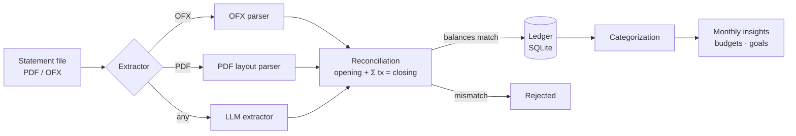

# fproject

**Local-first personal finance.** Import your monthly bank statements, see where your money goes, and plan for what you want next.

> 🚧 Early development. The project is being built in small, reviewable steps; see the [roadmap](#roadmap).

## Why

Banking apps show transactions. They don't answer the questions that matter at the end of the month:

- How much came in, and how much is left?
- Where is the money actually going, and how does that compare to last month?
- Am I within the limits I set for myself (e.g. food delivery)?
- I want to travel to Japan in 8 months for R$ 40,000. Is that feasible, and what has to give?

fproject answers these from your own statements, on your own machine. Your financial data never leaves your computer unless you choose an extractor that sends it somewhere.

## How it works



1. **Ingestion.** Every bank format sits behind a single `Extractor` interface. A file goes in; a statement with its transactions comes out. New banks mean new extractors, not changes to the core.
2. **Reconciliation.** Before anything is stored, the transactions must add up to the statement's own totals. This is what makes any extractor trustworthy, including an LLM one.
3. **Ledger.** A statement is unique per *(account, reference month)*. Transactions get a generated UUID; no bank-provided identifier is trusted as a key. Raw data is never modified.
4. **Categorization.** Category and scope (household vs. personal) live in a separate layer on top of the ledger, so a categorization mistake can never corrupt the raw data.
5. **Insights.** Reports, budgets and plans are read-only views over categorized data.

## Design principles

- **Local-first and private.** SQLite on disk. No personal data in the repository; tests use synthetic statements.
- **Money is an integer.** Amounts are stored in cents, signed: negative is outflow, positive is inflow.
- **Trust, but reconcile.** No import is accepted unless it balances.
- **Start small.** Each layer has to be useful on its own before the next one is built.

## Roadmap

**Phase 1: Ledger**
- [x] Domain model: accounts, statements, transactions
- [x] SQLite storage with one statement per account per month
- [ ] `Extractor` interface and reconciliation
- [ ] OFX extractor
- [ ] Generic PDF extractor (tested against a synthetic bank)
- [ ] LLM-based extractor as a pluggable alternative
- [ ] `import` command

**Phase 2: Categorization**
- [ ] Small, fixed set of categories
- [ ] Scope: household vs. personal
- [ ] Internal transfers (checking → savings, credit card bill payment) excluded from income and expense totals
- [ ] Assisted categorization with human confirmation

**Phase 3: Monthly insights**
- [ ] Income vs. expenses and what is left over
- [ ] Top spending categories
- [ ] Month-over-month tracking

**Phase 4: Budgets**
- [ ] Per-category monthly limits
- [ ] On-track / over-budget status

**Phase 5: Goals and planning**
- [ ] Savings goals with a target amount and date (e.g. a trip)
- [ ] Feasibility given current income and spending, and which levers would close the gap

**Phase 6: Agents (exploratory)**
- [ ] Housing advisor: compare current housing cost against market and financing options
- [ ] Spending coach for recurring categories such as food
- [ ] Investment buckets

## Development

Requires Python 3.12+ and [uv](https://docs.astral.sh/uv/).

```bash
uv sync               # create the environment
uv run pytest         # run tests
uv run ruff check .   # lint
uv run ruff format .  # format
```

## License

[MIT](LICENSE)
